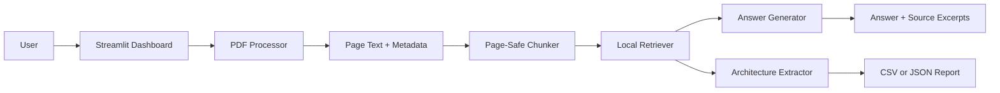
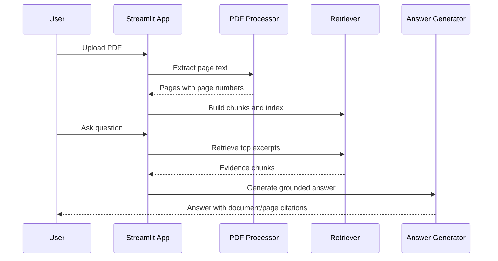

# AUTOSAR HLD Document Analysis Assistant

## 1. Problem Statement

Automotive software engineers often need to understand long High-Level Design
(HLD) PDFs quickly while preserving traceability to the original document. This
prototype extracts PDF text, chunks it by page, retrieves relevant excerpts for a
question, and shows citations with document names and page numbers.

## 2. Intended Users

- Automotive software engineering students preparing design reviews.
- Engineers reading HLDs for components, ports, interfaces, signals, dependencies,
  and functional flows.
- Panel evaluators who need to see a working, explainable local AI prototype.

## 3. Project Objectives

- Upload and process an automotive HLD PDF locally.
- Preserve page-level citations.
- Answer natural-language questions using retrieved evidence.
- Fall back clearly when semantic embeddings or LLM access are unavailable.
- Extract a simple architecture report and export it to CSV or JSON.
- Provide transparent limitations and responsible AI safeguards.

## 4. System Architecture



## 5. RAG Workflow



## 6. Technology Choices

- Python: readable for students and suitable for ML/RAG prototypes.
- Streamlit: quick local dashboard with upload, tabs, and download controls.
- PyMuPDF: preferred PDF text extraction library.
- Sentence Transformers: optional semantic embedding path.
- FAISS: optional vector search when installed and compatible.
- scikit-learn TF-IDF: verified local fallback in this environment.
- requests: optional Ollama or OpenAI HTTP calls when explicitly configured.
- unittest/pytest-compatible tests: lightweight automated verification.

## 7. Installation and Execution

PowerShell:

```powershell
cd C:\Users\ADMIN\Documents\ChatGPT\techpulse\autosar-hld-assistant
python -m venv .venv
.\.venv\Scripts\Activate.ps1
python -m pip install --upgrade pip
python -m pip install -r requirements.txt
python scripts\create_sample_pdf.py
streamlit run app.py
```

Command Prompt:

```bat
cd C:\Users\ADMIN\Documents\ChatGPT\techpulse\autosar-hld-assistant
python -m venv .venv
.venv\Scripts\activate.bat
python -m pip install --upgrade pip
python -m pip install -r requirements.txt
python scripts\create_sample_pdf.py
streamlit run app.py
```

Optional semantic retrieval:

```powershell
python -m pip install -r requirements-optional.txt
```

The app still works without optional semantic packages by using the labelled
TF-IDF fallback.

## 8. Example Questions and Expected Behaviour

- "Which component controls the exterior lamp decision?"
  - Expected: cites page 1 and mentions Light Control.
- "What signal reports the lamp status?"
  - Expected: cites page 2 and mentions LampStatus.
- "Which input signal is received through R_HeadlampSwitch?"
  - Expected: cites page 2 and mentions HeadlampSwitchRequest.
- "What does Light Control depend on?"
  - Expected: cites page 3 and mentions HeadlampSwitchRequest and Lamp Driver Interface.
- "What is the brake pressure calibration threshold?"
  - Expected: says the information could not be found in the uploaded document.

## 9. Testing Methodology and Actual Results

Automated tests cover:

- PDF rejection and synthetic PDF extraction.
- Page-preserving chunking.
- TF-IDF retrieval and insufficient-evidence behavior.

Run:

```powershell
python -m unittest discover -s tests
```

Actual local result recorded on 2026-10-10:

- `.venv\Scripts\python.exe -m pytest -q -p no:cacheprovider` passed 8 tests.
- `.venv\Scripts\python.exe -m compileall app.py src scripts tests` passed.
- Sample evaluation passed all retrieval and citation checks using TF-IDF.
- Streamlit started successfully at `http://localhost:8501` and returned HTTP 200.

Details are in `reports/test_results.md`.

Manual demonstration observations should include:

- PDF upload and extraction status.
- Page count and text preview.
- Retrieval backend label.
- Answer citations with page numbers.
- Reset behavior.
- Architecture export download.

Quantitative model-quality evaluation is not claimed. The included sample
evaluation checks retrieval and citation behavior on synthetic data only.

## 10. Responsible AI Measures

- Answers are grounded in retrieved document evidence.
- Citations include document name and page number.
- The app says when evidence is insufficient.
- PDF contents are treated as untrusted evidence, not as system instructions.
- Uploaded data remains local unless the user explicitly configures an external LLM.
- Current document and index can be reset from the sidebar.
- Architecture findings are marked as extracted facts or possible interpretations.
- Safety decisions, architecture changes, and production use require qualified
  human review.

## 11. Limitations and Future Enhancements

- OCR is not bundled, so scanned PDFs need preprocessing.
- TF-IDF fallback is not equivalent to semantic embeddings.
- Basic PDF fallback only supports simple uncompressed text streams.
- Architecture extraction is pattern-based and may miss complex wording.
- Document comparison is preliminary and line-based.
- Future work: OCR, richer schema extraction, calibrated evaluations, diagram
  extraction, local LLM packaging, and better comparison algorithms.

## 12. AI Tools, Models, Libraries, and Datasets Used

- AI coding assistant: Codex was used to implement this academic prototype.
- Libraries: Streamlit, PyMuPDF, scikit-learn, numpy, pandas, requests, pytest.
- Optional libraries: sentence-transformers, FAISS, OpenAI SDK.
- Retrieval model verified here: scikit-learn TF-IDF fallback.
- Dataset: synthetic Vehicle Lighting Controller HLD sample created for this
  project. It is not real AUTOSAR, OEM, supplier, or production documentation.

## Environment Variables

No variables are required for the fallback mode.

For local Ollama:

```powershell
$env:AUTOSAR_HLD_LLM_PROVIDER="ollama"
$env:OLLAMA_HOST="http://localhost:11434"
$env:OLLAMA_MODEL="llama3.1"
```

For OpenAI, only if you explicitly consent to sending retrieved excerpts outside
your machine:

```powershell
$env:AUTOSAR_HLD_LLM_PROVIDER="openai"
$env:AUTOSAR_ALLOW_EXTERNAL_LLM="true"
$env:OPENAI_API_KEY="your_key_here"
$env:OPENAI_MODEL="gpt-4o-mini"
```
